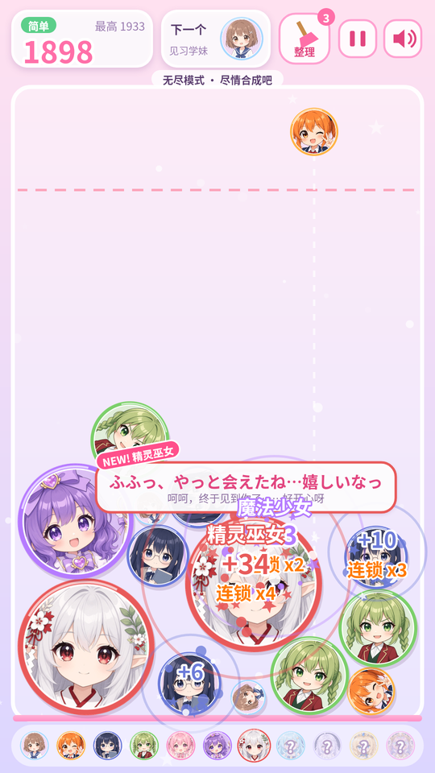

# 美少女合成 · AnimeMerge

> 二次元物理合成小游戏，玩法和「合成大西瓜」一样。下载、解压、双击就能玩。出品：狸猫

## 🎮 下载就能玩（Windows）

1. 打开 **[Releases（发布页）](https://github.com/limoaCatherine/anime-merge/releases/latest)**。
2. 下载 **`meishaonv-hecheng-windows.zip`**（约 155 MB），在文件上右键选「**全部解压缩**」。
3. 双击解压出来的 **`美少女合成\美少女合成.exe`** 就能开始玩，**不用安装**。

直接下载：[meishaonv-hecheng-windows.zip](https://github.com/limoaCatherine/anime-merge/releases/latest/download/meishaonv-hecheng-windows.zip)

### 🌐 网页版（Windows、Mac 等系统都能玩）

下载 **[`meishaonv-hecheng-web.zip`](https://github.com/limoaCatherine/anime-merge/releases/latest/download/meishaonv-hecheng-web.zip)**（约 5 MB），解压后双击 `美少女合成-网页版\index.html`，游戏会在浏览器中打开（推荐 Chrome 或 Edge）。**不需要联网。**

### ⚠ Windows 提示「Windows 已保护你的电脑」？

这个提示来自 SmartScreen。游戏没有购买代码签名证书，所以第一次运行时会出现这个提示。点 **「更多信息」→「仍要运行」** 即可。

## 玩法

点击投放二次元少女，**两个相同等级的角色碰到一起，就会合成为下一级角色**。从第 1 级「见习学妹」开始，一路合成到第 11 级「星海女神」。两个星海女神相遇时会双双升华，奖励 +1000 分。角色堆过顶部红色警戒线，游戏就结束了。

| 操作 | 鼠标 / 触屏 | 键盘 |
| --- | --- | --- |
| 瞄准 | 左右移动 / 按住拖动 | ← → 或 A D |
| 投放 | 点击 / 松开手指 | 空格 / 回车 / ↓ |
| 暂停 | 右上角 ⏸ | P / Esc |
| 整理道具（简单模式） | 「整理」按钮 | T |

| 难度 | 简单 | 普通 | 困难 |
| --- | --- | --- | --- |
| 投放倒计时 | 无 | 8 秒 | 4 秒 |
| 警戒线判负 | 3 秒 | 2 秒 | 1.5 秒 |
| 特殊规则 | 「整理」道具 ×3 | — | 场地变窄、重力更大，底部会升起石头 |
| 目标 | 无尽模式 | 合成「月之公主」（Lv9） | 合成「天空女王」（Lv10） |

每个难度的最高分分开保存。达成目标后，可以选择继续无尽挑战。

## 制作人员

- **出品：狸猫**
- 角色语音（[AivisSpeech](https://aivis-project.com/)）：
  - AivisSpeech: コハク
  - AivisSpeech: 凛音エル
  - AivisSpeech: みちのくあいり
  - AivisSpeech: らせつん
  - AivisSpeech: まお
  - **AivisSpeech: リダ / Lida**：https://youtube.com/channel/UC2tX473Zo09ZCnhAUNdAvjA/join
  - **Tαkoe:AivisSpeech:黄金笑**
- 语音模型授权：
  - コハク、凛音エル、みちのくあいり、らせつん、まお 使用 [ACML 1.0](https://github.com/Aivis-Project/ACML)。
  - リダ / Lida 使用作者自定的授权。
  - 黄金笑 使用 Tαkoeプロジェクト利用規約。
  - 授权全文见 [`docs/licenses/`](docs/licenses/)，Windows 版的 `美少女合成\licenses\` 文件夹里也有一份。
- 背景音乐：《星糖午后》，原创程序化作曲
- 物理引擎：[Matter.js](https://brm.io/matter-js/)（MIT License）
- 桌面版运行时：[Electron](https://www.electronjs.org/)（MIT License）

## 授权说明

- 本游戏免费下载和游玩。
- 游戏代码、角色立绘和背景音乐的版权归出品方「狸猫」所有，**未经许可不得转载、二次分发或商用**。
- 角色语音按上面各语音模型的授权条款使用。游戏中的语音不得单独提取或另作他用。
- Matter.js 和 Electron 按各自的 MIT License 使用，许可文本随 Windows 版一起提供（`LICENSE`、`LICENSES.chromium.html`）。

---

开发者：构建、测试、打包和项目结构见 **[docs/开发说明.md](docs/开发说明.md)**，完整设计文档见 [docs/README.md](docs/README.md)。
