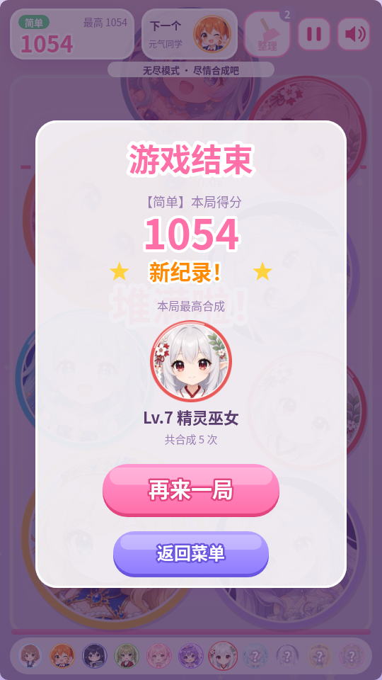

# 美少女合成 · AnimeMerge

> 竖屏物理合成小游戏（"合成大西瓜"类）｜HTML5 Canvas + Matter.js｜三档难度｜网页版 + Windows 桌面版

投放二次元少女头像，两个相同等级的角色碰到一起就合成为更高一级，共 11 级，最高级为「星海女神」。在经典合成玩法上，按难度拆分出投放倒计时、出生池权重、场地宽度、重力和石头障碍等规则，并用自动化机器人模拟验证每个难度的目标达成率。

<p>



</p>

## 玩法

- 左右瞄准、点击投放；每次只出最低几级的角色，顶部预告"下一个"。
- 同级相碰合成升级并得分，短时间连续合成有连锁加成；两个「星海女神」相遇双双升华，+1000 分。
- 静止角色越过顶部红色警戒线超过一定时间即游戏结束。
- 三档难度：简单（无尽）、普通（目标 Lv9「月之公主」）、困难（目标 Lv10「天空女王」），达成目标后可继续无尽挑战。

## 数值设计要点

- **难度全部数据驱动**（`src/config/DifficultyConfig.js`，系统代码无难度分支）：

  | 项目 | 简单 | 普通 | 困难 |
  | --- | --- | --- | --- |
  | 投放倒计时 | 无 | 8 秒 | 4 秒 |
  | 出生池权重（Lv1→Lv5） | 36/30/21/13 | 32/26/20/13/9 | 16/20/24/22/18（偏大角色） |
  | 警戒线判负 | 3 秒 | 2 秒 | 1.5 秒 |
  | 场地 / 重力 | 标准 | 标准 | 左右各收窄 12px，重力 ×1.15 |
  | 道具 / 障碍 | 「整理」×3 | — | 石头：首块 18 秒、之后每 25 秒，邻接合成 2 次碎裂，最多 3 块 |

- **成长与得分曲线**：11 级角色的半径与合成得分逐级递增（得分 1→66，见 `docs/README.md` 角色等级表）；连锁窗口 0.8 秒，每多一连锁额外 +2 分。
- **用模拟校准目标**：`tools/bot-sim.mjs` 在真实构建上用固定种子跑贪心机器人。原困难目标「星海女神」在模拟中达成率为 0%，因此下调为「天空女王」并放宽场地；调整后的结果（每档 40 局，见 `docs/bot-sim-strategic.json`）：普通目标达成率 97%，困难 15%，简单（无尽）平均存活 386 秒。
- **留存**：三档难度最高分分别保存；每位角色在一局中第一次出现时播放语音并显示「NEW!」，强化合成新角色的反馈。

## 技术栈

HTML5 Canvas 2D · 原生 JavaScript (ES Modules) · Matter.js 0.19 · esbuild · Electron · Playwright · WebAudio（实时合成音效）· AivisSpeech（角色语音）· Python（程序化作曲 BGM）

## 如何运行

```bash
npm install
npm start              # 构建并在 http://localhost:8765 启动
npm run build          # 构建到 dist/，可直接双击 dist/index.html
npm test               # 浏览器自动化测试
npm run desktop        # Electron 桌面版
npm run package:win    # 打包 Windows x64
node tools/bot-sim.mjs # 难度模拟（需先 build）
```

详细的难度表、语音台词、换皮说明见 [docs/README.md](docs/README.md)（其中困难模式的场地宽度与目标等级早于最近一次调整，以 `src/config/DifficultyConfig.js` 为准）。

## 关于开发方式

本项目使用 AI 辅助开发（代码实现与部分素材生成）；玩法设计、难度规则与数值调优由作者完成。

## 署名

角色语音使用 AivisSpeech 及相应声音模型，授权说明见 `docs/licenses/`；物理引擎 Matter.js (MIT)；BGM 为原创程序化作曲。
