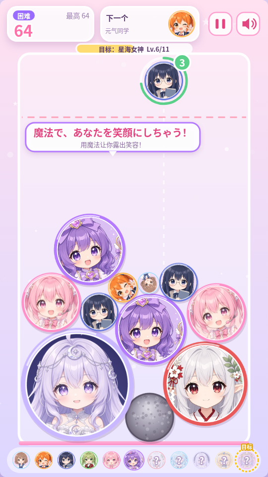
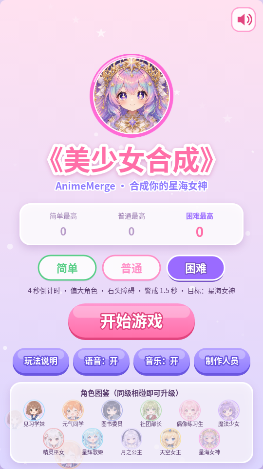

# 《美少女合成》AnimeMerge

一款"合成大西瓜 / Suika Game"玩法的 2D 物理合成小游戏：投放可爱的二次元少女头像，两个相同等级碰到一起就会合成为更高级的角色，最终目标是合成出第 11 级 **「星海女神」**！

- 技术栈：纯 HTML5 Canvas + JavaScript (ES Modules) + [Matter.js](https://brm.io/matter-js/) 物理引擎
- 完全离线：Matter.js 已放在 `vendor/`，音效由 WebAudio 实时合成，角色语音与背景音乐为预生成的音频文件
- 原创背景音乐：轻松可爱的 lo-fi / 八音盒循环曲，菜单与游戏中连续播放，可单独开关
- 三种难度（简单 / 普通 / 困难），各难度最高分分别保存
- 每位角色在一局中**第一次登场**时，会用符合她形象的声线说一句日语台词（AivisSpeech 自然人声风格语音 + 日中双语字幕 + 「NEW!」徽章）
- 竖屏 9:16，自动适配窗口；支持鼠标、触屏和键盘
- 四个平台共用一套代码：浏览器 / Windows 桌面版（Electron）/ **抖音小游戏**（`douyin/`，1.8 新增）/ **微信小游戏**（`wechat/`，1.8 新增）
- 出品：狸猫

| 困难模式 | 主菜单 |
| --- | --- |
|  |  |

---

## 一、如何运行

### ★ 方式 1：桌面版（推荐给玩家）
双击 **`release\美少女合成\美少女合成.exe`** —— 游戏在独立窗口中运行，没有命令行黑框、没有浏览器。

- Windows 10/11 x64，无需安装任何运行库（自带 Electron 运行时，不依赖 WebView2 / Python / Node）
- 可以把整个 `美少女合成` 文件夹复制到任何位置；右键 exe →「发送到 → 桌面快捷方式」即可放到桌面
- 窗口为竖屏 9:16，按屏幕高度自动调整大小，拖动缩放时保持比例；重复双击只会激活已打开的窗口
- 存档（各难度最高分、设置）保存在 `%APPDATA%\AnimeMerge`，删除/更新游戏文件夹不会丢失
- 首次运行时 Windows SmartScreen 可能提示"已保护你的电脑"（exe 未做代码签名），点击「更多信息 → 仍要运行」即可

### 方式 2：浏览器直接玩
双击 `dist/index.html` 即可（已打包成单个经典脚本，`file://` 下不会有跨域问题）。

### 方式 3：开发模式（修改源码时）
需要 Node.js 18+：
```bash
npm install          # 安装 esbuild / matter-js / playwright (仅开发需要)
npm run build        # 打包 src/ -> dist/
npm run serve        # 启动本地服务器 http://localhost:8765/
```
- `http://localhost:8765/index.html`：**开发版**，直接加载 `src/` 下的 ES 模块源码（改完刷新即可，必须通过服务器访问）
- `http://localhost:8765/dist/index.html`：**发布版**，修改源码后需重新 `npm run build`
- Windows 上也可以双击 `tools\dev-start.bat`：自动用 Python 或 Node 启动本地服务器并在浏览器中打开 `dist/index.html`（仅供开发调试）
- `npm run desktop`：用开发模式的 Electron 打开桌面窗口（可用开发者工具）

### 打包桌面版 (Windows x64)
```bash
npm install
npm run package:win      # -> release/美少女合成/美少女合成.exe
```
流程（`tools/package.mjs`）：`npm run build` → 组装最小应用目录（`desktop/` + `dist/` + package.json）→ `@electron/packager` 打包 win32-x64（app.asar）→ `tools/win-resources.mjs` 用纯 JS 的 `resedit` 写入 exe 图标与版本信息（产品名「美少女合成」、公司「狸猫」、版权「Copyright © 2026 狸猫」），**在 Linux/macOS 上打包也不需要 wine**。

- 修改图标：替换 `assets/images/girl_11.png` 后运行 `npm run icons`（生成 `assets/icons/app.ico` 16~256 多尺寸、`app.png`、`favicon.png`），再重新打包
- 修改版本号：改 `package.json` 的 `version`
- 打包时会把 `docs/licenses/`（语音模型授权全文）复制到 `release/美少女合成/licenses/`
- 桌面外壳代码：`desktop/main.js`（窗口大小、标题、背景色、单实例、禁用开发者工具、外部链接用系统浏览器打开、允许语音自动播放）

### 抖音小游戏版（1.8 新增）
```bash
npm run build:douyin     # -> dist-douyin/ ，并同步复制到 douyin/
npm run test:douyin      # Node + 模拟 tt + 无头画布 运行 douyin/game.js 的自动化验证 (68 项)
node tools/test-douyin.mjs --shots && python3 tools/make_search_images.py   # 重新生成商店截图
```
- **AppID / 激励视频广告位 ID 只在一个文件里填**：`src/config/PlatformConfig.js`（文件顶部 TODO），填完重新 `npm run build:douyin`
- 用抖音开发者工具「导入项目」选择 `douyin/` 目录即可预览/上传；完整上架流程、资质（软著/备案）、隐私协议草稿、商店文案与截图见 **`douyin/抖音上架说明.md`**（源文件 `docs/douyin/`）
- 包结构：主包（game.js + 压缩立绘 + 预渲染 wav 音效）约 1.0 MB（上限 4 MB）；分包 `media/`（11 句语音 + BGM mp3）约 1.4 MB，进入菜单前用 `tt.loadSubpackage` 加载并显示进度；整体约 2.4 MB（上限 20 MB）
- 与网页版的差异：音效改为预渲染 wav（无 mp3 首尾静音，`npm run sfx` 由同一套 WebAudio 合成代码离线渲染，`tt.createInnerAudioContext` 播放）；BGM 只用 mp3（iOS 不支持 ogg）——用「一遍 + 开头 4 秒」的 `bgm_main_loop.mp3`（`python3 tools/make_douyin_bgm.py` 生成）由两个播放器在循环点交叉淡化，消除 mp3 循环空隙；开局自动录屏，结算/胜利面板「分享精彩片段」；侧边栏复访奖励（每天 1 次，下一局 +1 整理）；启动画面显示健康游戏忠告、适龄提示（8+）与著作权登记号（在 PlatformConfig 填写）

### 微信小游戏版（1.8 新增）
```bash
npm run build:wechat     # -> dist-wechat/ ，并同步复制到 wechat/ (用户电脑上改名为「微信小游戏」)
npm run test:wechat      # Node + 模拟 wx + 无头画布 运行 wechat/game.js 的自动化验证 (68 项)
node tools/test-wechat.mjs --shots   # 重新生成 docs/wechat/screenshots/ 截图
```
- AppID / 激励广告位 ID 填在同一个文件 `src/config/PlatformConfig.js` 的 `wechat` 段（AppID 已填 `wx6def2bda0bd75e11`；改回 TODO 时 project.config.json 会变成 `touristappid` 游客模式）
- 用微信开发者工具「导入项目」选择 `wechat/` 目录；完整上架流程（注册、认证、资质、备案、提审、流量主，含官方文档链接与需要手机扫码的步骤）见 **`docs/微信上架说明.md`**（也复制在 `wechat/微信上架说明.md`），商店文案 / 隐私政策草稿 / 截图在 `docs/wechat/`
- 与抖音版的差异：`WechatPlatform` 继承 `DouyinPlatform` 的画布/触摸/音频/存储/分包实现；没有录屏和侧边栏，改为结算/胜利面板「分享给好友」(`wx.shareAppMessage`) + 右上角转发 (`wx.onShareAppMessage`) / 分享到朋友圈 (`wx.onShareTimeline`)；激励广告 `wx.createRewardedVideoAd` 以 `res.isEnded` 判定看完；`game.json` 用小写 `subpackages`；包体上限主包 4 MB / 整体 30 MB

### 平台抽象层与激励广告（1.8 新增）
- `src/platform/`：`Platform`（接口）→ `WebPlatform` / `ElectronPlatform` / `DouyinPlatform` → `WechatPlatform`。画布、触摸/鼠标/键盘、图片加载、音频、存储、前后台、广告、录屏、分享、侧边栏全部经由平台层；**游戏逻辑与 systems 中不出现 window / document / tt**（`build:douyin` 会静态检查）
- `AdService.showRewardedAd(placement)` → `Promise<boolean>`（与其他小游戏相同接口）：抖音且填了 adUnitId 时用真实 `tt.createRewardedVideoAd`；网页版显示 5 秒占位广告（URL 加 `?noads` 关闭）；桌面版、以及未填广告位的抖音版**不出现任何看广告入口**
- 抖音未填广告位时（流量主只能上线后开通）：复活改为每局 1 次免费「再试一次」，+1 整理隐藏；填上广告位 ID 后自动恢复看视频复活/+1 整理（`PlatformConfig.douyin.freeReviveWithoutAds`）
- 广告位：① **看视频复活**（每局 1 次，清掉警戒线附近及以上的角色后继续）② **整理次数用完后看视频 +1 整理**（每局 1 次）。次数在 `PlatformConfig.ads`

### 自动化测试
```bash
npx playwright install chromium   # 首次需要
npm run build && npm test
```
桌面版测试（Linux 上打包同一份应用并在虚拟屏幕中运行）：
```bash
npm run package:linux && xvfb-run -a npm run test:desktop
```
验证：打包模式运行、窗口标题、无菜单栏、9:16 窗口、开发者工具已禁用、从 app.asar 内加载、图片/语音加载、开局问候与合成语音自动播放、单实例锁、localStorage 存档跨重启保留、无控制台错误。

逻辑审计回归测试（1.7 新增，44 项，主循环冻结、固定随机种子、按 1/60 秒手动推进，结果可复现）：
```bash
npm run build && xvfb-run -a npm run test:audit
```
覆盖：合成竞态（3 个同级同时接触 / 与刚移除的角色合成 / 判负后合成 / 暂停中合成 / 刚投放的角色合成）、大角色出生点限制在墙内、高速不穿墙与穿墙救回、困难场地两个天空女王必然相遇、下方角色消失后上方继续下落、警戒线（新投放不计时 / 短暂弹起不判负 / 卡住抖动也会判负 / 胜利继续后计时清零且仍能判负 / 目标只触发一次）、投放（狂按只投 1 个 / 窄场地瞄准限制 / 超时自动投放位置限制 / 暂停停表 / 失去焦点自动暂停 / 重开全部重置 / 触摸取消不投放 / 多点触控）、石头（选堆积最低处 / 太满时推迟 / 数量上限 / 只有紧邻合成才开裂 / 重开清除）、整理道具、困难目标、分难度最高分、「下一个」预览一致、开局只出 1~3 级、目标进度条不被待投放角色挡住、长字幕不溢出、窗口缩放坐标换算、语音（暂停中不开始新台词 / 判负与返回菜单时取消）、重新开始时背景音乐不重头播放。

浏览器版测试会用无头浏览器验证：无控制台报错、语音文件存在并可播放、难度选择、简单难度的「整理」道具、普通难度 8 秒倒计时自动投放与最后 3 秒滴答声、暂停时停表、合成「月之公主」胜利并继续无尽、困难难度 4 秒倒计时 / 窄场地 / 石头升起与碎裂、同级合成与语音字幕、连续合成只播最高级语音、最高级合成大奖、警戒线判负、分难度最高分存档，以及开发版源码可运行。

---

## 二、玩法

| 操作 | 鼠标 / 触屏 | 键盘 |
| --- | --- | --- |
| 瞄准 | 左右移动 / 按住拖动 | ← → 或 A D |
| 投放 | 点击 / 松开手指 | 空格 / 回车 / ↓ |
| 暂停 | 右上角 ⏸ 按钮 | P / Esc |
| 整理（简单） | HUD「整理」按钮 | T |
| 选难度（菜单） | 点击 简单/普通/困难 | ← → 或 1 2 3 |

- 每次只会出现最低几级中的角色（简单 4 级，普通/困难 5 级；开局前几个只出最低 3 级），顶部显示"下一个"
- 两个**相同等级**的角色接触 → 在接触点合成为下一级，并获得分数（短时间内连续合成有"连锁"加成）
- 两个**「星海女神」**相遇 → 双双升华消失，**+1000 分**大奖
- 静止的角色越过顶部**红色警戒线**持续一段时间（简单 3 秒 / 普通 2 秒 / 困难 1.5 秒）→ 游戏结束
- 各难度的最高分、通关记录分别保存在浏览器 `localStorage` 中

### 难度设计

配置文件：`src/config/DifficultyConfig.js`

| 项目 | 简单 | 普通 | 困难 |
| --- | --- | --- | --- |
| 投放倒计时 | 无 | 每次 8 秒（超时在当前瞄准位置自动投放） | 每次 4 秒 |
| 倒计时提示 | — | 待投放角色外圈进度环 + 数字，最后 3 秒滴答声 | 同左 |
| 可投放等级 | 1~4 级 | 1~5 级 | 1~5 级（权重偏向大角色 16/20/24/22/18） |
| 警戒线判负时间 | 3 秒 | 2 秒 | 1.5 秒 |
| 场地 / 重力 | 标准 | 标准 | 左右各收窄 12px（宽 472；1.6 版为 22px / 452），重力 ×1.15 |
| 道具 | 「整理」×3：清除场上当前最小等级的全部角色 | — | — |
| 障碍 | — | — | 每约 25 秒（首次 18 秒）预警 1.5 秒后从底部升起一块石头：位置从 8 个随机候选中选**堆积最低**的一列；如果升起后会把角色顶到警戒线附近则**推迟 3 秒再试**（预警期间那一列被堆高也会取消）。石头不能合成，紧邻发生 2 次合成（含两个星海女神的大奖合成）后碎裂（会显示裂纹）；场上最多 3 块 |
| 目标 | 无尽模式 | 合成「月之公主」(Lv9) → 胜利，可选继续无尽 | 合成「天空女王」(Lv10) → 胜利，可选继续无尽（1.6 版为「星海女神」，机器人模拟中达成率 0%，见下方「平衡性模拟」） |
| 最高分 | 单独保存 | 单独保存 | 单独保存 |

- 暂停（或切到后台、窗口失去焦点）时倒计时、石头计时、物理全部停止，排队的角色台词也会等到继续后再播放
- 胜利后选择「继续挑战」时，所有角色的警戒计时清零、倒计时重置
- HUD 显示难度标签、目标进度胶囊（如「目标：月之公主 Lv.6/9」），底部进化链用金色虚线圈标出目标角色

### 平衡性模拟（1.7 新增）

`tools/bot-sim.mjs` 在真实游戏代码中用固定随机种子跑很多局（主循环冻结，按 1/60 秒手动推进；每 1.3 秒投放一次）。两种机器人：

- **基础机器人**（`--grad 0`）：对 31 个候选位置计算直落会先碰到谁 / 落点高度；同级相碰优先，避免压住更小的角色，避免越线
- **策略机器人**（`--grad 0.5`，默认）：在基础机器人之上加「角落策略」——大的放一侧、小的放另一侧，接近认真玩的玩家

每个难度 40 局（每局最长 1500 秒游戏时间），1.7 版参数下的结果：

| 难度（目标） | 机器人 | 平均分 | 平均存活 | 平均最高级 | 目标达成率 | 平均达成时间 |
| --- | --- | --- | --- | --- | --- | --- |
| 简单（无尽） | 基础 / 策略 | 3070 / 3427 | 358 / 386 秒 | Lv9.1 / Lv9.3 | — | — |
| 普通（月之公主 Lv9） | 基础 / 策略 | 2075 / 2396 | 231 / 257 秒 | Lv8.9 / Lv9.2 | **65% / 97%** | 150 / 139 秒 |
| 困难（天空女王 Lv10） | 基础 / 策略 | 1343 / 1484 | 134 / 142 秒 | Lv8.8 / Lv9.1 | **5% / 15%** | 128 / 143 秒 |
| 困难·1.6 版参数（星海女神 Lv11，宽 452） | 基础 / 策略 | 1303 / — | 131 秒 | Lv8.7 | **0% / 0%** | — |

- 普通的目标（月之公主）：基础机器人约 6~7 成、策略机器人几乎必达 —— 对真人来说属于"认真玩可以通关"的难度
- 困难原目标「星海女神」：无论哪种机器人、哪个难度（包括简单无尽 40 分钟）都**从未**合成出星海女神——11 级的面积总和几乎等于整个容器，需要极其精确的规划。因此困难的目标改为「天空女王」(Lv10)，并把场地放宽到 472（两个天空女王直径之和 520 仍大于场地宽度，必然会互相接触，能合成为星海女神，作为通关后的终极挑战）
- 复现：`npm run build && node tools/bot-sim.mjs 40 4 --max-time 1500`（`--difficulty hard`、`--grad 0`、`--json out.json`、`--set '{"hard":{"containerInset":12}}'` 可调参对比）；结果保存在 `docs/bot-sim-*.json`

### 角色语音台词（AivisSpeech）

- 每局游戏中，每位角色只在**第一次被合成出来**时说话（字幕带「NEW! 角色名」徽章）；之后再合成出同一角色只有普通的合成音效
- 新的一局（新游戏 / 重新开始 / 更换难度）会重置
- 第 1 级「见习学妹」的台词作为开局问候（算作她的首次登场）

1.5 版起语音由 **AivisSpeech Engine 1.2.0**（基于 Style-Bert-VITS2，由 BERT 根据整句意思生成语调与节奏）生成。
1.6 版把第 2~11 级换成更有感情的二次元少女声线（模型与风格见下表，**所有模型均允许商用（含游戏）**，授权见下方「语音授权说明」）。
**1.7 版**：针对「语速太慢、像机器人、感情不够」——模型和风格完全不变（第 1 级コハク・あまあま 也保持原模型/风格，只调快语速），但：
- **语速加快**：年轻/元气角色 1.18~1.25，女王/女神 1.12（原来 0.95~1.0）
- **几乎不留空白**：句首 0.05 秒、句尾 0.1 秒（`prePhonemeLength` / `postPhonemeLength`），并把句中超过 0.15 秒的停顿压缩到 0.1 秒
- **感情更强**：感情强度 `intonationScale` 1.4~1.5，语速缓急 `tempoDynamicsScale` 1.2~1.3
- **台词更短更口语**：每位角色一句 1.5~3 秒的短台词，带「えへへっ」「わぁっ」「ふふっ」「もう～」等语气词

配置：`src/config/VoiceConfig.js`（台词、字幕、朗读文本、引擎/模型/风格与参数、署名）；语音文件：`assets/audio/voice/voice_01.mp3 ~ voice_11.mp3`

| 等级 | 角色 | 语音模型（风格） | 语速 / 感情强度 / 语速缓急 / 音高 | 时长 | 台词 | 中文 |
| --- | --- | --- | --- | --- | --- | --- |
| 1 | 见习学妹 | コハク（あまあま） | 1.2 / 1.4 / 1.3 / 0 | 2.06 秒 | えへへっ…よろしくねっ、先輩♡ | 嘿嘿……请多关照哦，前辈♡ |
| 2 | 元气同学 | 凛音エル（Happy） | 1.25 / 1.5 / 1.3 / +0.03 | 1.52 秒 | もう～、早く遊ぼうよっ！ | 真是的～快来一起玩嘛！ |
| 3 | 图书委员 | みちのくあいり（標準） | 1.2 / 1.45 / 1.3 / +0.02 | 2.25 秒 | あ、あのっ…お話し、しよ？ | 那、那个……我们聊聊天吧？ |
| 4 | 社团部长 | リダ / Lida（キュート） | 1.25 / 1.5 / 1.3 / +0.03 | 1.70 秒 | えへへっ、任せてくださいっ！ | 嘿嘿，交给我吧！ |
| 5 | 偶像练习生 | らせつん（喜び） | 1.25 / 1.5 / 1.3 / +0.03 | 2.66 秒 | わぁっ！ステージ、見ててねっ♪ | 哇！要好好看我的舞台哦♪ |
| 6 | 魔法少女 | 黄金笑（Positive） | 1.18 / 1.5 / 1.2 / +0.03 | 1.93 秒 | えいっ！魔法、かけちゃうよっ！ | 嘿！看我施展魔法啦！ |
| 7 | 精灵巫女 | まお（あまあま） | 1.18 / 1.5 / 1.3 / +0.02 | 2.66 秒 | ふふっ、やっと会えたね…嬉しいなっ | 呵呵，终于见到你了……好开心呀 |
| 8 | 星辉歌姬 | リダ / Lida（元気２） | 1.22 / 1.5 / 1.3 / +0.02 | 1.46 秒 | わーいっ！一緒に歌おっ♪ | 哇——！一起唱歌吧♪ |
| 9 | 月之公主 | コハク（せつなめ） | 1.18 / 1.5 / 1.3 / +0.02 | 1.75 秒 | えへへ…ずーっと、待ってたの♡ | 嘿嘿……我一直、一直在等你哦♡ |
| 10 | 天空女王 | まお（からかい） | 1.12 / 1.5 / 1.3 / 0 | 2.40 秒 | あらあら、よく来たわね…ふふっ♡ | 哎呀呀，你来得正好嘛……呵呵♡ |
| 11 | 星海女神 | まお（おちつき）+ 轻混响 | 1.12 / 1.45 / 1.3 / −0.01 | 2.12 秒 | ふふっ、ずーっと一緒だよ♡ | 呵呵，要永远在一起哦♡ |

生成与质检（`tools/generate_voices.mjs` + `tools/pick_voice_takes.py`）：
- `pitchScale` 只做 ±0.03 以内的微调（幅度再大会劣化音质）；容易读错的词换了说法（如「笑顔」被读成「でがお」→ 改为「魔法、かけちゃうよっ」）
- **选 take**：AivisSpeech 每次合成略有不同，每句生成 **8 个候选**（第 7 级 16 个）：先用 faster-whisper 语音识别比对台词（字符错误率），只保留读音正确的候选（不超过最低错误率 + 0.04）；再从中选**感情最丰富**的一条——音高范围、音高标准差、能量动态三项在候选内标准化后求和取最高。结果记录在 `docs/voice-qa.json`（剩余错误率主要是识别器漏掉「えへへっ」「ふふっ」这类语气词）
- 后期：裁首尾静音 → 压缩句中长停顿 → 低切 100Hz → 4kHz 轻微削减 2dB → 齿音抑制 → 女神加轻混响 → 响度统一到 **−20 LUFS**（实测 −20.0~−20.5）→ 44.1kHz 单声道 96kbps mp3
- 也保留 VOICEVOX 支持：把某句的 `voice.engine` 设为 `'voicevox'` 并填写 VOICEVOX 的 `styleId` 即可

语音系统规则（`src/systems/VoiceSystem.js`）：
- 使用 `HTMLAudioElement` 播放 mp3，`file://` 双击运行和桌面版（app.asar 内）都能出声
- 同一时刻有多位角色首次登场时，先播放**最高等级**的台词，其余排队在当前语音结束后播放（最多等待 9 秒）；更高等级可以打断正在播放的低等级台词；两句之间至少间隔 0.6 秒，不会叠音
- 菜单可单独开关「语音」，并遵守右上角的全局静音；音量由「音量设置」控制
- 若语音文件加载失败，自动改用浏览器自带的 `speechSynthesis`（ja-JP）朗读
- 字幕气泡（日文 + 小字中文 + NEW! 徽章）在合成位置附近显示，时长 = max(3.4 秒, 语音时长 + 0.8 秒)；台词较长时自动在标点处折成两行；静音时字幕照常显示

### 背景音乐与音量

- 曲目：**《星糖午后》(Starlight Sugar Afternoon)** —— 原创，由 `tools/compose_bgm.py` 程序化作曲并渲染（numpy 合成器，未使用任何第三方音源/采样/音乐素材，无版权问题）
  - 风格：轻松可爱的 lo-fi + 八音盒；F 大调，84 BPM，swing 八分音符
  - 编制：八音盒主旋律、FM 电钢琴和弦、柔和贝斯、暖色铺底、轻量 lo-fi 鼓（底鼓/边击/沙锤）、极轻黑胶噪声、混响
  - 和弦：Fmaj7 – Am7 – B♭maj7 – C7sus/C7 – Dm7 – Gm7 – Gm7/C7 – Fmaj7；24 小节（A 旋律 / B 旋律 / A 旋律 + 高八度点缀）≈ 68.6 秒
  - 无缝循环：渲染时把越过循环点的延音与混响尾音叠回开头，首尾波形连续；`assets/audio/bgm/bgm_main.ogg`（主用，循环无缝）与 `bgm_main.mp3`（兜底）
- 播放（`src/systems/BgmSystem.js`）：
  - 全局服务，菜单 → 游戏 → 结算之间连续播放，**不会**因切换场景而重新开始
  - `HTMLAudioElement` 循环播放，`file://` 与桌面版都可用；浏览器版在第一次点击后开始，桌面版启动即播放
  - 菜单「音乐：开/关」与游戏暂停面板「音乐」按钮单独开关（会保存）；遵守右上角全局静音
  - 窗口隐藏/最小化时暂停，回来后从原位置淡入继续
  - 角色台词播放时自动把 BGM 压低到 55%（约 −5 dB），台词结束后平滑恢复
- 默认音量（1.5 版再次整体调低）：

  | 声音 | 100% 时的音量 | 1.4 版 | 音频文件响度 |
  | --- | --- | --- | --- |
  | 角色语音 | 0.30 | 0.50 | −20 LUFS（原 −16） |
  | 合成音效 | 0.12 | 0.25 | WebAudio 实时合成 |
  | 背景音乐 | 0.15（台词播放时 ×0.55） | 0.28 | −22 LUFS（原 −16.8） |

  按以上默认值，台词比 BGM 高约 8 dB，BGM 闪避时约 13 dB，始终清晰；即使把滑块拉满也不会刺耳。
- **音量设置面板**（菜单左上角「推子」图标，或游戏中 暂停 → 「音量」）：总音量 0~100%，角色语音 / 音效 / 背景音乐 各 0~200%（100% = 推荐音量），拖动立即生效并保存；「恢复默认」一键回到 100%。实际音量 = 声道 100% 音量 × 声道滑块 × 总音量（`src/systems/MixerSystem.js`）
- 旧存档迁移：存档带有设置版本号（`SaveSystem.SETTINGS_VERSION = 3`）。旧版本存档中保存的音量会被丢弃并改用新的默认值，最高分/通关记录/开关等设置保留。

### 制作人员 / 署名（Credits）

菜单「制作人员」面板中同样列出以下信息：

- 出品：狸猫
- 角色语音（AivisSpeech）：AivisSpeech: コハク / AivisSpeech: 凛音エル / AivisSpeech: みちのくあいり / AivisSpeech: リダ / Lida / AivisSpeech: らせつん / Tαkoe:AivisSpeech:黄金笑 / AivisSpeech: まお
- リダ / Lida：https://youtube.com/channel/UC2tX473Zo09ZCnhAUNdAvjA/join
- 背景音乐：《星糖午后》原创（程序化作曲，tools/compose_bgm.py）
- 物理引擎：Matter.js（MIT License）；桌面版运行时：Electron（MIT License）

#### 语音授权说明

- 语音合成软件：AivisSpeech Engine（LGPL-3.0）——只在开发时离线生成 mp3，**不随游戏分发**；语音模型本身也**不随游戏分发**，游戏里只有生成好的 mp3
- 7 个语音模型均来自 AivisHub，**全部允许商用（含游戏）**：

| 模型 | 使用等级 | AivisHub UUID | 授权 | 署名要求 | 制作 / 声音提供 |
| --- | --- | --- | --- | --- | --- |
| コハク | 1, 9 | 22e8ed77… | ACML 1.0 | 任意（按作者希望标注「AivisSpeech: コハク」） | オズチャット -Oz Chat- / Trippy（CV：ねゆたろ） |
| まお | 7, 10, 11 | a59cb814… | ACML 1.0 | 任意（「AivisSpeech: まお」） | オズチャット -Oz Chat- / Trippy（CV：ねゆたろ） |
| みちのくあいり | 3 | 1b2830f4… | ACML 1.0 | 任意 | こずかた学園プロジェクト / Aivis Project（声：上戸恵里） |
| らせつん | 5 | 9f36ec0d… | ACML 1.0 | 任意 | こずかた学園プロジェクト / Aivis Project（声：上戸恵里） |
| 凛音エル | 2 | f5017410… | ACML 1.0 | 任意 | kokuren / 電脳天使工業 |
| リダ / Lida（感情表现模型） | 4, 8 | 446d2053… | 作者自定授权：商用·非商用均可 | **必须**注明角色名「リダ」或「Lida」及 URL https://youtube.com/channel/UC2tX473Zo09ZCnhAUNdAvjA/join | リダ |
| 黄金笑_T2 | 6 | 734c12b6… | Tαkoeプロジェクト利用規約：商用·非商用、个人·法人均可 | **必须**著作权表示，格式如「Tαkoe:AivisSpeech:黄金笑」 | Yumehaki Project V / VSMB Project |

- ACML 1.0：除禁止事项（冒充话者本人、诽谤中伤、虚假信息、诈骗、政治/宗教宣传、犯罪等）外，个人/法人、营利/非营利均可使用，**包括游戏**。全文见 `docs/licenses/ACML-1.0.md`，或 https://github.com/Aivis-Project/ACML
- リダ 授权全文：`docs/licenses/Lida-voice-model.txt`。禁止：模型的二次分发/转让、作为训练素材、暴力或性相关用途、损害「リダ」角色形象/品牌或其他被认为不当的用途。**注意：作者声明该授权可能随时变更**——发布前/更新时请到 AivisHub 模型页确认最新条款
- Tαkoe 规约全文：`docs/licenses/Takoe-project-tos.txt`（原文 http://wedst.pj.ymhk.jp/tos.html）。禁止：无著作权表示的使用、违反公序良俗、宗教活动、反社会势力、**赌博相关用途**、损害角色形象、侵害第三方权利等；未经生成者许可二次利用本游戏生成的语音也属禁止
- **抖音小游戏 / 含激励广告的商业发行（1.8 复核）**：三种授权都允许商用（法人、营利均可），没有排除「带广告的免费游戏」或特定平台（但见下一条：部分权利方指南要求企业事先联系）。发行物里只有生成好的 mp3，不含任何语音模型，所以不涉及リダ「禁止二次分发/转让」（指模型本身）与 Tαkoe「禁止无改动再分发模型」的条款；生成的语音按授权可在作品中使用，需保留署名（游戏内「制作人员」面板已列出 リダ/Lida + URL、Tαkoe:AivisSpeech:黄金笑）。注意：不得用于性暗示/暴力内容（リダ）、赌博相关（Tαkoe），宣传文案不得夸大虚假（ACML）
- **⚠ 法人商用需联系确认（1.8 复核，未替换）**：コハク/まお（オズチャット二次創作ガイドライン：法人・营利事业者事先联系 Trippy）、凛音エル（作者 BOOTH 版规约：企业使用联系 @wangoroge_333）、みちのくあいり/らせつん（こずかた学園指南：企业长期商用联系运营）。这些模型在 AivisHub 上是 ACML 1.0（允许法人商用），但权利方指南另有要求，详见 `docs/licenses/角色权利方指南-复核-2026-10-11.md`。リダ、黄金笑无需联系
- 未采用：ACML-NC（仅限非营利）模型、CC BY-SA（相同方式共享）模型、条款需另行到外部网站确认的模型、来源不明的试作模型
- 1.5 版使用的 リアボVC 系模型（さつき・れな・もえ・ほのか・かりん・わかな）与 morioki 已全部替换，游戏中不再包含这些声音

### 角色等级表

| 等级 | 名称 | 半径 | 合成得分 |
| --- | --- | --- | --- |
| 1 | 见习学妹 | 22 | 1 |
| 2 | 元气同学 | 30 | 3 |
| 3 | 图书委员 | 39 | 6 |
| 4 | 社团部长 | 49 | 10 |
| 5 | 偶像练习生 | 60 | 15 |
| 6 | 魔法少女 | 72 | 21 |
| 7 | 精灵巫女 | 85 | 28 |
| 8 | 星辉歌姬 | 99 | 36 |
| 9 | 月之公主 | 114 | 45 |
| 10 | 天空女王 | 130 | 55 |
| 11 | 星海女神 | 148 | 66 |

---

### 1.7 逻辑审计（问题 → 修复）

对合成、警戒线、物理、投放、石头、道具/目标、出块、界面、音频做了系统检查。每一项都有对应的自动化测试（`tools/test-audit.mjs`，旧版代码上相应用例会失败）。

| # | 发现的问题 | 修复 |
| --- | --- | --- |
| 1 | 合成配对中的一方在处理前被移除时，另一方会**永久**处于"合成中"状态：既不能再合成，也不参与判负 | 合成处理时检查双方；无效配对取消并清除标记；胜利/判负时清空待处理合成 (`MergeSystem.cancelPending`) |
| 2 | 判负后已排队的合成仍可能执行 | 合成被禁用时队列中的合成一律取消 |
| 3 | 合成出的大角色按"55% 初始半径"限制出生点，长大到 100% 时嵌进墙/地面，可能把旁边的小角色挤穿墙 | 按长大后的**完整半径**把出生点限制在容器内 |
| 4 | 没有速度上限：极端高速时角色会直接穿墙飞出（旧版实测 x = −27663） | 每步限速 40px，并加"安全网"：跑到容器外的刚体自动放回容器内 |
| 5 | 卡在警戒线上**不停抖动**的角色（速度一直大于"静止"阈值）永远不会判负 | 除速度外，0.4 秒内净位移 < 6px 也视为静止 |
| 6 | 胜利后「继续挑战」保留了之前的警戒计时，可能一继续就直接判负 | 继续时清零所有警戒计时并重置倒计时 |
| 7 | 困难目标「星海女神」实际不可达：机器人在所有难度中都从未合成出星海女神（容器面积几乎装不下整条进化链） | 困难目标改为「天空女王」(Lv10)，场地 452 → 472；星海女神作为通关后的终极挑战（窄场地下两个天空女王必然相遇，可以合成） |
| 8 | 石头在完全随机的位置升起，可能把角色顶过警戒线造成不公平判负 | 从 8 个候选中选堆积最低的一列；太满时推迟 3 秒；预警期间那一列被堆高则取消本次 |
| 9 | 两个星海女神的大奖合成不会让紧邻的石头开裂 | 石头同时监听大奖合成 |
| 10 | 窗口失去焦点（Alt+Tab 但窗口仍可见）不会暂停，倒计时在玩家看不到时自动投放 | 失去焦点自动暂停 |
| 11 | 触摸被系统取消（来电、系统手势）被当成"抬起"→ 意外投放；在窗口外松开鼠标时瞄准状态残留 | `pointercancel` / 指针捕获丢失 / 失焦 → 取消瞄准，不投放 |
| 12 | 判负后、返回菜单后，排队的角色台词仍会继续播放（结算画面/菜单里还在说话） | 判负、离开游戏场景时立即停止并清空台词队列 |
| 13 | 暂停中排队的台词仍会开始播放 | 暂停时保留队列，继续游戏后再播放 |
| 14 | 顶部目标进度胶囊会被待投放的大角色和倒计时秒数挡住 | 胶囊自动避让到远离瞄准位置的一侧；两侧都放不下时换成紧凑版「目标 Lv.x/y」 |
| 15 | （工具）短台词首尾几乎没有留白时语音识别经常输出空结果，选 take 失真 | 转写前两端补 0.6 秒静音，并关闭"无语音"过滤 |

检查后确认**无需修改**（均有测试覆盖）：同一物理步一个角色只参与一次合成（3 个同级同时接触只合成一对）；暂停/胜利/判负期间物理与合成停止；新投放角色穿过警戒线不计时；短暂弹到线上不判负；物理未启用休眠，下方角色消失后上方会继续下落；投放冷却 0.55 秒防狂按；瞄准与超时自动投放都按当前角色半径限制在场地内；暂停时倒计时停止；重新开始时投放数/道具次数/石头/角色全部重置；石头数量上限；只有紧邻石头的合成才会开裂；「整理」空场不可用且每局重置；目标只触发一次；最高分按难度分别保存、低分不覆盖；「下一个」预览与实际一致；开局前 4 次只出 1~3 级；长字幕自动折行；窗口缩放后坐标正确；重新开始不会让背景音乐重头播放。

设计上保留：前一个角色还在下落时可以投放下一个（同类游戏的标准手感，只受 0.55 秒冷却限制）。

## 三、项目结构

```
AnimeMerge/
├─ release/
│  └─ 美少女合成/           ★ 桌面版 (双击 美少女合成.exe)
│     ├─ 美少女合成.exe
│     ├─ resources/app.asar  游戏本体 (desktop/ + dist/)
│     └─ *.dll / *.pak / locales/ …  Electron 运行时
├─ douyin/                ★ 抖音小游戏工程 (用抖音开发者工具导入此目录；npm run build:douyin 生成)
│  ├─ game.js / game.json / project.config.json
│  ├─ images/ sfx/         主包资源 (压缩立绘、预渲染音效)
│  ├─ media/               分包：voice/*.mp3、bgm/bgm_main.mp3
│  ├─ 抖音上架说明.md
│  └─ 上架资料/            隐私协议草稿、商店文案、截图 (不会被打进小游戏包)
├─ wechat/                ★ 微信小游戏工程 (用微信开发者工具导入此目录；npm run build:wechat 生成)
│  ├─ game.js / game.json / project.config.json (compileType game)
│  ├─ images/ sfx/         主包资源 (压缩立绘、转发卡片 share.png、预渲染音效)
│  ├─ media/               分包：voice/*.mp3、bgm/bgm_main_loop.mp3
│  ├─ 微信上架说明.md
│  └─ 上架资料/            隐私协议草稿、商店文案、截图 (不会被打进小游戏包)
├─ desktop/
│  ├─ main.js              Electron 主进程 (桌面窗口外壳)
│  └─ icon.png             窗口图标
├─ index.html              开发版入口 (ES Module，需本地服务器)
├─ package.json            npm 脚本: build / serve / test / package:win / package:linux / test:desktop / icons / voices
├─ dist/                   ★ 发布版 (双击 dist/index.html 即可玩)
│  ├─ index.html, favicon.png
│  ├─ game.js              esbuild 打包后的全部游戏代码
│  ├─ style.css
│  ├─ assets/icons/          app.ico (16~256) / app.png / favicon.png
├─ vendor/matter.min.js
│  └─ assets/  images/girl_XX.png, audio/voice/voice_XX.mp3, audio/bgm/bgm_main.ogg|mp3
├─ src/
│  ├─ main.js              入口：创建 Game 并启动
│  ├─ style.css
│  ├─ main.douyin.js       抖音入口 (DouyinPlatform)
│  ├─ main.wechat.js       微信入口 (WechatPlatform)
│  ├─ platform/            平台抽象层 Platform / WebPlatform / ElectronPlatform / DouyinPlatform / WechatPlatform
│  ├─ lib/matter.js        统一导出 Matter (网页/桌面读 vendor 全局；抖音版打包 npm matter-js，不访问 DOM)
│  ├─ config/
│  │  ├─ GameConfig.js     画面/容器/物理/节奏/配色等全局参数
│  │  ├─ LevelConfig.js    11 级角色表 (图片、名称、半径、分数、颜色)
│  │  ├─ DifficultyConfig.js 三种难度规则 + resolveRules()
│  │  ├─ VoiceConfig.js    11 句台词 (日文/中文/TTS 文本)、语音模型/风格/参数、署名、语音音量
│  │  └─ AudioConfig.js    音效/BGM 默认音量、BGM 文件、闪避参数、音量滑块设置 (MixerConfig)
│  ├─ core/
│  │  ├─ Game.js           主循环、画布缩放、全局服务装配
│  │  ├─ EventBus.js       事件总线 (发布/订阅)
│  │  ├─ StateMachine.js   有限状态机
│  │  ├─ Scene.js          场景基类
│  │  ├─ SceneManager.js   场景切换 + 淡入淡出 + 输入分发
│  │  └─ AssetLoader.js    图片预加载 (失败时生成占位图)
│  ├─ scenes/
│  │  ├─ BootScene.js      加载进度
│  │  ├─ MenuScene.js      主菜单 / 玩法说明 / 图鉴
│  │  ├─ GameScene.js      按难度组合各系统 (playing / paused / victory / over 状态)
│  │  └─ GameOverScene.js  结算
│  ├─ systems/
│  │  ├─ PhysicsSystem.js  Matter.js 封装，固定步长，重力随难度
│  │  ├─ SpawnSystem.js    当前/下一个角色按难度权重随机 + 投放冷却
│  │  ├─ DropTimerSystem.js 投放倒计时 / 最后 3 秒滴答 / 超时自动投放
│  │  ├─ ItemSystem.js     「整理」道具
│  │  ├─ ObstacleSystem.js 困难模式石头：预警、升起、开裂、碎裂
│  │  ├─ GoalSystem.js     难度目标 / 胜利 / 继续无尽
│  │  ├─ VoiceSystem.js    日语角色语音 (首次登场、排队、冷却、兜底 TTS)
│  │  ├─ BgmSystem.js      背景音乐 (跨场景循环、开关、静音、隐藏暂停、台词闪避)
│  │  ├─ MixerSystem.js    音量混合：总音量 + 语音/音效/音乐 声道 (持久化)
│  │  ├─ SubtitleSystem.js 语音字幕气泡
│  │  ├─ MergeSystem.js    同级碰撞合成、最高级大奖
│  │  ├─ ScoreSystem.js    计分、连锁
│  │  ├─ InputSystem.js    Pointer Events + 键盘 → 逻辑坐标
│  │  ├─ AudioSystem.js    WebAudio 合成音效 (订阅玩法事件自动发声)
│  │  ├─ EffectSystem.js   粒子、光环、飘字、闪光、震屏
│  │  └─ SaveSystem.js     localStorage 存档 + 设置版本迁移
│  ├─ entities/
│  │  ├─ Character.js      角色实体 (圆形刚体 + 头像贴图)
│  │  └─ Stone.js          石头障碍实体 (程序生成纹理 + 裂纹)
│  └─ ui/
│     ├─ HUD.js            分数/难度/下一个/整理/按钮/目标进度/进化链
│     ├─ Button.js         画布按钮 (主/次/图标/选项卡) + 图标
│     ├─ CountdownRing.js  待投放角色的倒计时环
│     ├─ VictoryPanel.js   胜利面板
│     ├─ CreditsPanel.js   制作人员 / 署名面板
│     ├─ SettingsPanel.js  音量设置面板 (菜单与暂停共用)
│     ├─ Slider.js         画布滑块
│     └─ draw.js           绘制工具函数
├─ assets/
│  ├─ images/girl_01.png ... girl_11.png   圆形透明头像 (256px，带分级描边)
│  ├─ images/source/girl_XX_raw.jpg        原始立绘
│  ├─ audio/voice/voice_01..11.mp3          角色语音 (AivisSpeech 生成)
│  └─ audio/bgm/bgm_main.ogg / .mp3         背景音乐 (原创，程序化作曲)
├─ assets/icons/          app.ico (16~256) / app.png / favicon.png
├─ vendor/matter.min.js    Matter.js 0.19.0 (离线)
├─ tools/
│  ├─ build.mjs            esbuild 打包脚本
│  ├─ serve.js             零依赖本地静态服务器
│  ├─ process_images.py    原图 → 圆形头像 (Pillow)
│  ├─ generate_voices.mjs  台词 → 语音 mp3 (AivisSpeech / VOICEVOX 引擎 HTTP API + ffmpeg)
│  ├─ pick_voice_takes.py  多个候选语音中用语音识别挑出读音最准的一条 (faster-whisper)
│  ├─ compose_bgm.py       程序化作曲并渲染背景音乐 (numpy + ffmpeg)
│  ├─ make_icons.py        头像 → app.ico / app.png / favicon.png
│  ├─ package.mjs          桌面版打包 (Electron)
│  ├─ win-resources.mjs    写入 exe 图标与版本信息 (resedit)
│  ├─ dev-start.bat        开发用：本地服务器 + 浏览器打开
│  ├─ test.mjs             浏览器版自动化测试 (Playwright)
│  └─ test-desktop.mjs     桌面版自动化测试 (Playwright + Electron)
└─ docs/README.md          本文档
```

### 架构图

```
                    ┌──────────────────────────────── Game ────────────────────────────────┐
  window / canvas → │  InputSystem ──emit──►  EventBus  ◄──on── AudioSystem / VoiceSystem   │
                    │                           ▲   │                                       │
                    │  SaveSystem   AssetLoader │   │ input:* 转发                           │
                    │                           │   ▼                                       │
                    │                     SceneManager (淡入淡出)                           │
                    │       ┌──────────┬─────────┴──┬──────────────┐                        │
                    │   BootScene  MenuScene   GameScene     GameOverScene                  │
                    └──────────────────────────────┼───────────────────────────────────────┘
                                                   │ resolveRules(难度) → rules
                                                   │ 组合 (StateMachine: playing/paused/victory/over)
   ┌─────────────┬────────────┬──────────────┬─────┴───────┬─────────────┬──────────────┬──────────┐
 Physics      Spawn       DropTimer        Merge         Score        Obstacle        Goal      Item
 (Matter.js)  (权重)      (倒计时)          │             ▲            (石头)          ▲
   │ physics:collision ─────────────────────┘             │              ▲              │
   │                                       merge {level, sources} ───────┴──────────────┘
   │                                         │ (EventBus)
   │                     ┌───────────────────┼───────────────────┬────────────────┐
   │               EffectSystem         AudioSystem        VoiceSystem ──voice:line──► SubtitleSystem
   └──► Character / Stone 实体
```

数据流：`InputSystem` 把鼠标/触屏转换为 540×960 的逻辑坐标 → `SceneManager` 转发给当前场景 → `GameScene` 投放 `Character` → `PhysicsSystem` 推进并广播碰撞 → `MergeSystem` 判断同级合成并发出 `merge` 事件 → `ScoreSystem`、`EffectSystem`、`AudioSystem` 各自响应。系统之间不直接互相调用，只通过事件总线解耦；难度差异全部体现在 `rules` 数据中，场景与系统里没有 `if (difficulty === ...)` 分支。

全局音频服务由 `Game` 持有、与场景无关：`AudioSystem`（音效）、`VoiceSystem`（台词，发出 `voice:line` / `voice:start` / `voice:end`）、`BgmSystem`（背景音乐，监听 `audio:mute`、`app:hidden/visible`、`voice:start/end` 实现静音、隐藏暂停与闪避），因此 BGM 跨场景连续播放。

主要事件：`drop`、`merge`、`merge:max`、`score:changed`、`timer:tick`、`timer:expired`、`stone:warn/spawn/hit/break`、`item:tidy`、`goal:reached`、`game:start`、`game:over`、`voice:line`、`danger:warn`。

---

## 四、如何换皮 (Reskin)

1. **替换角色图片**
   - 最简单：直接用自己的 **256×256 圆形透明 PNG** 覆盖 `assets/images/girl_01.png` ~ `girl_11.png`
   - 或者：把原图放到 `assets/images/source/girl_XX_raw.jpg`，运行 `python tools/process_images.py`（需要 `pip install pillow`），自动裁成圆形并加描边（描边颜色在脚本 `RING_COLORS` 中修改）
2. **修改角色名称/大小/分数/颜色**：编辑 `src/config/LevelConfig.js`；数量可增减，`MAX_LEVEL` 自动计算
3. **修改标题、配色、手感**：编辑 `src/config/GameConfig.js`（`title`、`colors`、`physics.gravityY`、`dangerY`、`dropCooldown`、`spawnTierCount` 等）
4. **修改难度**：编辑 `src/config/DifficultyConfig.js`（倒计时、投放权重、判负时间、场地收窄、重力、道具次数、目标等级、石头参数），也可以新增难度并加入 `DIFFICULTY_ORDER`
5. **修改台词 / 声线 / 重新生成语音**：编辑 `src/config/VoiceConfig.js` 中的 `text`（字幕）、`zh`（翻译）、`tts`（朗读文本）、`voice`（`engine`、`modelUuid`、`styleId`、`speed/intonation/tempo`）和 `credit`（署名），然后：
   ```bash
   # 1) 启动 AivisSpeech Engine (Windows 直接打开 AivisSpeech 应用即可；Linux 用 AivisSpeech-Engine 的 ./run --port 10101)
   #    缺少的模型会按 modelUuid 自动从 AivisHub 安装；http://127.0.0.1:10101/speakers 可查看 styleId
   # 2) 需要 ffmpeg 在 PATH 中
   npm run voices                                        # 每句生成 1 条，直接写入 assets
   node tools/generate_voices.mjs --only 3,5             # 只重做第 3、5 句
   # 推荐：每句多生成几条，再自动挑选 (需 pip install faster-whisper pykakasi numpy)
   node tools/generate_voices.mjs --takes 8 --out build/voice-takes
   python tools/pick_voice_takes.py build/voice-takes   # 先看读音是否正确，再选感情起伏最大的一条 (--only voice_07 只处理某句)
   ```
   更换模型时请先确认该模型在 AivisHub 上的授权（商用请选 ACML 1.0 / CC0，或确认作者自定授权允许商用），并按授权要求更新 `credit` 署名。
   也可以直接用自己录制的 mp3 覆盖 `assets/audio/voice/voice_XX.mp3`
6. **修改 / 重新生成背景音乐**：编辑 `tools/compose_bgm.py` 中的 `BPM`、`PROG`（和弦进行）、`MEL_A/MEL_B`（旋律），然后
   ```bash
   pip install numpy            # 另需 ffmpeg
   python tools/compose_bgm.py  # 输出 assets/audio/bgm/bgm_main.ogg 与 .mp3
   ```
   也可以换成自己的循环曲（同名 ogg/mp3 覆盖即可；第三方音乐请确认授权，例如 CC0）；音量在 `src/config/AudioConfig.js` 调整
7. **重新打包**：`npm run build`，然后打开 `dist/index.html`

> 提示：图片只要文件名与 `LevelConfig.js` 里的 `image` 路径一致即可，可以改用 `.webp` 等格式。

---

## 五、说明

- 角色立绘均为原创二次元风格形象，不涉及已有版权角色
- 浏览器策略要求用户首次点击后才能播放声音，所以菜单界面第一次点击之前没有音效（背景音乐在第一次点击后开始，开局问候语在点击「开始游戏」后播放；桌面版不受此限制）
- 角色语音由 AivisSpeech（AivisHub 模型，ACML 1.0 / リダ授权 / Tαkoe 规约，均可商用）合成，署名见上方「制作人员」；背景音乐为原创程序化作曲
- 部分浏览器在 `file://` 下可能限制 `localStorage`，若最高分没有保存，请使用桌面版 exe（或 `tools\dev-start.bat` 以服务器方式运行）
